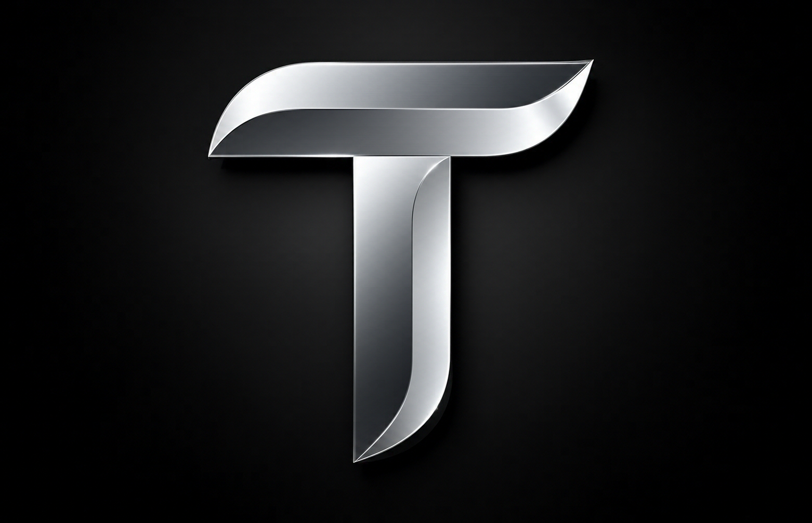

<div align="center">



# TOKENFORGE

### Turn messy documents into clean, token-efficient context for AI.

**A local-first document optimization tool for preparing PDFs, presentations, spreadsheets, Word files, text files, and images for LLM workflows.**

[](https://www.python.org/)
[](https://streamlit.io/)
[](https://github.com/openai/tiktoken)
[](https://github.com/Hamza-227/TOKENFORGE/actions)
[](LICENSE)
[](#privacy-and-local-processing)
[](https://hamza-227.github.io/TOKENFORGE/)

**Upload · Extract · Optimize · Validate · Export**

[**Website**](https://hamza-227.github.io/TOKENFORGE/) · [**Quick start**](#getting-started) · [**Features**](#features) · [**Report a bug**](https://github.com/Hamza-227/TOKENFORGE/issues)

</div>

---

## What is TOKENFORGE?

Documents are not always ready to be used with AI. PDFs can contain repeated headers and footers, presentations can include slide clutter, and spreadsheets can contain large amounts of empty or unnecessary structure. Converting these files with a basic text extractor can also damage tables, headings, and the relationships between pieces of information.

**TOKENFORGE prepares documents for AI by extracting their content, reducing avoidable formatting noise, measuring token usage, and exporting structured Markdown.**

Use the generated files as context for tools such as ChatGPT, Claude, Gemini, NotebookLM, or as input to your own Retrieval-Augmented Generation (RAG) workflow.

### Why use it?

- **Reduce unnecessary token usage:** remove document noise and compare the token count before and after optimization.
- **Keep information structured:** preserve headings, slide references, tables, and other useful document structure where supported.
- **Choose your compression level:** select a preservation-first, balanced, or maximum-compression mode.
- **Review before using:** inspect optimized Markdown, token metrics, and validation reports.
- **Keep processing local:** files are processed on your own machine; no cloud document-conversion API or API key is required.

> **Important:** Token savings depend on the input. A short, already-clean document may become slightly larger after Markdown formatting. Always review the exported content before relying on it.

---

## At a glance

| | |
|---|---|
| **Application** | Local web app: custom HTML/CSS/JS interface (monochrome "silver on black") served by FastAPI. The original Streamlit UI is still included as `app.py`. |
| **Language** | Python 3.12+ |
| **Input formats** | PDF, PPTX, DOCX, XLSX, CSV, TXT, PNG, JPG, JPEG, TIFF |
| **Main output** | Structured, token-optimized Markdown |
| **Additional output** | Extracted assets, JSON reports, summary file, ZIP bundle |
| **Token measurement** | `tiktoken` using `cl100k_base`, with a word-estimation fallback |
| **Database / API keys** | Not required |
| **OCR** | Local Tesseract OCR (optional, for scanned pages and images) |

---

## Features

### Document extraction

- **PDF:** extracts text and tables, organizes content, and detects scanned pages.
- **PowerPoint (`.pptx`):** extracts slide titles, bullet points, tables, speaker notes, and slide references.
- **Word (`.docx`):** maps document heading styles, lists, tables, and embedded media into a Markdown-friendly structure.
- **Excel (`.xlsx`) and CSV:** identifies table density and selects Markdown tables or compact CSV-style output.
- **Text (`.txt`):** reads UTF-8 text and cleans formatting noise.
- **Images:** uses local OCR to extract readable text and preserves visual assets where supported.

### Three optimization modes

| Mode | Best for | What it does |
|---|---|---|
| **A — Preservation First** | Important reports, research, and source material | Cleans spacing and formatting artifacts while aiming to preserve all extracted information. |
| **B — Balanced** | Everyday document-to-AI workflows | Removes verified repeated headers and footers, compacts tables, and reduces unnecessary blank space. |
| **C — Maximum Compression** | Large context-heavy documents | Uses more aggressive compact formatting, abbreviations, and list compaction. Review this output carefully. |

### Token measurement and validation

- Compares original and optimized token counts.
- Reports tokens saved, percentage reduction, and processing time.
- Uses `tiktoken` with the `cl100k_base` encoding when available.
- Falls back to a word-based estimate when tokenizer data is unavailable.
- Checks important numbers and entities such as dates, percentages, URLs, and email addresses.
- Flags empty output or potential content-integrity issues before export.

**Tokenizer note:** `cl100k_base` is the counting method used by TOKENFORGE. Token counts can differ from the tokenizer used by another model or AI provider, so treat them as a consistent comparison rather than a universal billing estimate.

### Image and OCR handling

- Runs OCR locally through Tesseract when needed.
- Uses image hashing (SHA-256) to identify duplicate images.
- Saves extracted visual assets in a relative assets folder and links them from the generated Markdown where supported.
- Does not require a paid cloud-vision API.

---

## Screenshots

<!-- TODO: take real screenshots of the running app and save them in assets/screenshots/ -->
<!--  -->

Run the app and capture: the three-step upload screen, the results dashboard, and the Markdown inspector. A short GIF of a full run is the single best thing you can add to this section.

---

# Getting started

## 1. Requirements

- Python **3.12 or newer**.
- Git, if you want to clone the repository.
- Tesseract OCR is optional. Install it if you want OCR support for scanned PDFs and images.
- An internet connection may be needed on the first run for `tiktoken` to download its tokenizer vocabulary. Document processing itself is performed locally.

## 2. Download the project

```bash
git clone https://github.com/Hamza-227/TOKENFORGE.git
cd TOKENFORGE
```

Alternatively, download the repository as a ZIP from GitHub and extract it.

## 3. Create a virtual environment

A virtual environment keeps TOKENFORGE's Python packages separate from other projects.

### Windows — PowerShell

```powershell
python -m venv venv
.\venv\Scripts\Activate.ps1
```

If PowerShell blocks activation, you can use Command Prompt instead:

```bat
venv\Scripts\activate.bat
```

### Linux / macOS

```bash
python3 -m venv venv
source venv/bin/activate
```

## 4. Install dependencies

With the virtual environment activated, run:

```bash
python -m pip install --upgrade pip
pip install -r requirements.txt
```

## 5. Install Tesseract OCR (optional)

Skip this step if you only need text-based document extraction. Install Tesseract if you want to extract text from scanned PDF pages or image files.

- **Windows:** use the [UB Mannheim Tesseract installer](https://github.com/UB-Mannheim/tesseract/wiki). During installation, note the install location and ensure Tesseract is available on your system PATH.
- **Ubuntu / Debian:**
  ```bash
  sudo apt update
  sudo apt install tesseract-ocr
  ```
- **macOS with Homebrew:**
  ```bash
  brew install tesseract
  ```

After installation, reopen your terminal so the updated PATH is available.

## 6. Start TOKENFORGE

Choose one of the following methods.

**Option A — Use the launcher**

- Windows: double-click `run.bat`.
- Linux / macOS:
  ```bash
  chmod +x run.sh
  ./run.sh
  ```

The launcher is designed to create the virtual environment and install the requirements on the first run, then start the app on later runs.

**Option B — Start Streamlit manually**

```bash
python server.py     # or: python main.py
```

Streamlit will print a local address in the terminal (usually `http://localhost:8501`). Open that address in your browser.

---

# How to use TOKENFORGE

You do not need to write code to use the application. Once TOKENFORGE is running, follow these steps in the browser.

The main page is a simple three-step flow: **1 Add documents → 2 Choose compression → 3 Run**. The sidebar shows engine status (tokenizer and OCR).

### Step 1 — Add your documents

Use the **Drag & drop** tab to select one or more supported files, or the **Local folder** tab to scan a directory. To explore the workflow without preparing files, click **Try with sample files**.

Supported extensions:

`PDF` · `PPTX` · `DOCX` · `XLSX` · `CSV` · `TXT` · `PNG` · `JPG` · `JPEG` · `TIFF`

### Step 2 — Choose compression

Pick the mode that matches your goal (open **Advanced** to change the output folder or include original copies):

- Choose **Preservation First** when retaining extracted details is the priority.
- Choose **Balanced** for a practical balance between readability and compactness.
- Choose **Maximum Compression** when reducing token usage is the priority. Review this output more carefully because it uses aggressive compaction.

### Step 3 — Run

Click **Start optimization**. TOKENFORGE will extract the content, analyze document structure, generate compact output candidates, measure token usage, and run its validation checks.

Processing time depends on the number, size, and complexity of your files. Scanned documents may take longer, especially when OCR is required.

### Step 4 — Review the results

After processing, review the information shown in the results area:

- **Original tokens:** the measured or estimated token count before optimization.
- **Optimized tokens:** the measured or estimated token count after optimization.
- **Tokens saved:** the difference between the two counts.
- **Reduction percentage:** the relative change in token count.
- **Processing time:** how long the document took to process.

Open the optimized Markdown preview and compare it with the raw extracted content where available. Check tables, dates, totals, names, URLs, and other important details. Review any validation warnings before using the result.

### Step 5 — Export your files

Use **Download ZIP bundle** to get the generated files. You can also use **Copy Markdown** to copy an optimized document and paste it into an AI chat or your own RAG workflow.

The exported Markdown is designed to be easier to inspect and provide as AI context. It does not guarantee that an AI model will interpret every document perfectly.

### A simple example workflow

Imagine you have a 40-page PDF report and want to ask an AI assistant questions about it:

1. Start TOKENFORGE.
2. Select **Balanced** mode.
3. Upload the PDF.
4. Click **Start Optimization**.
5. Review the Markdown preview and validation results.
6. Download the ZIP or copy the Markdown.
7. Provide the optimized Markdown to your chosen AI tool and ask your questions.

For confidential documents, remember that TOKENFORGE processes files locally, but uploading the exported Markdown to a third-party AI service will share that content with that service. Check the service's privacy terms and your organization's policies first.

---

## Supported file formats

| File type | Extensions | Extraction approach | Typical output |
|---|---|---|---|
| PDF | `.pdf` | PyMuPDF; Tesseract for scanned pages | Structured Markdown with page references |
| PowerPoint | `.pptx` | `python-pptx` | Slide-by-slide Markdown, tables, and speaker notes |
| Word | `.docx` | `python-docx` | Markdown headings, lists, and tables |
| Excel | `.xlsx` | `openpyxl`, `pandas` | Markdown tables or compact CSV-style blocks |
| CSV | `.csv` | `pandas` | Compact tables or sanitized CSV-style output |
| Plain text | `.txt` | UTF-8 text reader | Cleaned Markdown/text |
| Images | `.png`, `.jpg`, `.jpeg`, `.tiff` | Pillow, OpenCV, and Tesseract OCR | Extracted text and preserved visual assets |

Legacy `.doc` Word files are not listed as supported input. Save them as `.docx` before processing.

---

## How token optimization works

TOKENFORGE uses a multi-stage pipeline:

```text
             YOUR DOCUMENT
                    │
                    ▼
          1. EXTRACT CONTENT
       Text · Tables · Slides · Media
                    │
                    ▼
           2. ANALYZE STRUCTURE
       Repeated headers · Footers · Noise
                    │
                    ▼
          3. GENERATE FORMATS
       Structured Markdown · Compact · CSV
                    │
                    ▼
           4. MEASURE TOKENS
          Compare candidate outputs
                    │
                    ▼
           5. VALIDATE CONTENT
       Numbers · URLs · Emails · Key terms
                    │
                    ▼
              6. EXPORT
        Markdown · Reports · ZIP bundle
```

### Metrics

**Tokens saved**

```text
Tokens Saved = Original Tokens - Optimized Tokens
```

**Reduction percentage**

```text
Reduction (%) = (Tokens Saved / Original Tokens) × 100
```

A positive reduction means the optimized output uses fewer tokens. A negative reduction means the output is larger than the original representation.

---

## Example: before and after

**Before — extracted slide text**

```text
Quarterly Operations Review - Confidential
Page 14 of 42
Quarterly Operations Review - Confidential

* Our production infrastructure achieved 99.98% availability during Q3.
* Total incidents recorded: 3 minor incidents, 0 major outages.
* Cost savings realized: approximately $250,000 across 4 clusters.

Company Confidential - Internal Use Only - Do Not Distribute
Page 14 of 42
```

**After — compact, structured Markdown**

```markdown
## Slide 14: Quarterly Operations Review

- Production infrastructure availability: **99.98%** (Q3)
- Incidents: 3 minor, 0 major outages
- Cost savings: **$250,000** (across 4 clusters)

Source: Slide 14
```

The documented example changes from approximately 84 tokens to approximately 38 tokens, a 54.7% reduction. Actual results vary by document and tokenizer.

---

## Output files

A processing batch can generate a structure similar to the following:

```text
TOKENFORGE_OUTPUT/
├── optimized/
│   ├── document_01.md
│   └── presentation_02.md
├── assets/
│   └── document_01/
│       ├── image_01.png
│       └── diagram_02.png
├── reports/
│   ├── compression_report.json
│   └── validation_report.json
├── originals/
│   └── (optional source copies)
└── TOKENFORGE_SUMMARY.md
```

The application also generates a ZIP bundle for downloading the processing results.

| Output | What it contains |
|---|---|
| `optimized/*.md` | Optimized Markdown for each processed document |
| `assets/` | Extracted visual assets, where available |
| `compression_report.json` | Compression and token metrics |
| `validation_report.json` | Validation information and warnings |
| `TOKENFORGE_SUMMARY.md` | Batch summary |
| ZIP bundle | Packaged output for download |

---

## Privacy and local processing

TOKENFORGE is designed to process documents on your own computer:

- No user registration or account is required.
- No cloud database is required.
- No external document-conversion API key is required.
- Document extraction and optimization run locally.
- No analytics or telemetry service is described as part of the application.

**Keep in mind:** the first `tiktoken` use may need an internet connection to obtain tokenizer vocabulary. Also, local processing does not control what happens after you choose to upload exported content to another online service.

Do not treat any software as a security certification. For sensitive business, legal, or personal documents, review the code and your organization's data-handling requirements before use.

---

## Troubleshooting

| Problem | What to try |
|---|---|
| `python` is not recognized | Reinstall Python and enable **Add Python to PATH**, then reopen the terminal. |
| `ModuleNotFoundError: fastapi` (or `uvicorn`) | Activate the virtual environment and run `pip install -r requirements.txt`, then `python server.py`. |
| Token counts show an estimate | `tiktoken` may not have its vocabulary available. Connect to the internet for the first run, then retry. |
| A scanned PDF or image returns little/no text | Install Tesseract OCR, confirm it is on PATH, and try a clearer scan. |
| OCR results contain mistakes | OCR accuracy depends on image quality, resolution, language, and handwriting. Review the extracted text. |
| The optimized output is larger | This can happen with small or already-clean files. Try Maximum Compression or keep the original when it is clearer. |
| A `.doc` file is not processed | Open it in Word or another office editor and save it as `.docx`. |
| Files with the same name are processed | The application is designed to avoid overwriting same-named files with different extensions; check the generated output names. |

If you encounter a reproducible bug, open a GitHub Issue and include your operating system, Python version, steps to reproduce, and the error message. Do not attach confidential source documents or sensitive data.

---

## Version 1.2.0 — UI redesign

- **New default interface:** plain HTML, CSS and JavaScript (`web/index.html`) served by a small FastAPI server (`server.py`). Same Python engine, same features. Start it with `python server.py` (or `run.sh` / `run.bat`) and it opens at http://127.0.0.1:8501.
- The Streamlit version is kept as an optional alternative: `streamlit run app.py`.
- New monochrome "silver on black" theme with film grain, glass cards and animated hover effects (`theme.py`, pure CSS — no external requests, still fully offline).
- Clearer three-step workflow; settings moved from the sidebar into the main flow.
- One hero metric (net token reduction) with supporting stats.
- Results table now uses real numeric columns with progress bars, so sorting works.
- Proper button hierarchy: one primary action per section.
- New home page (with a **Try it out** button) and the tool combined in one HTML file, with embedded Inter and Instrument Serif fonts and a larger logo.
- Processing, extraction, optimization and validation logic are unchanged.

## Version 1.1.0 highlights

- Fixed OCR handling for images and scanned PDF pages.
- Reduced duplicated PDF table content, scrambled heading order, and unnecessary Markdown scaffolding.
- Improved Word table placement and compact table formatting.
- Protected URLs, email addresses, and code during compression.
- Avoided deleting numeric lines and rounding spreadsheet numbers.
- Improved validation for number formats, vocabulary coverage, and empty output.
- Prevented same-named files with different extensions from overwriting each other.
- Improved portable relative image links and folder scanning, including hidden folders.
- Removed launch-directory assumptions from application paths.

---

## Home page and web interface

`web/index.html` is one self-contained file (fonts and logo are embedded, so it works offline):

- **Home page** — opens first. It explains TOKENFORGE and has a **Try it out** button.
- **Tool** — **Try it out** switches to the converter in the same page (`#tool`). **← Home** goes back.
- The footer links to the repository and to the author.

`docs/index.html` is the same file, for GitHub Pages (repository **Settings → Pages → Deploy from a branch → `main` / `/docs`**). On GitHub Pages there is no Python engine, so the tool view shows how to run TOKENFORGE locally. If you edit `web/index.html`, copy it to `docs/index.html`.

## Contributing

See [CONTRIBUTING.md](CONTRIBUTING.md) and the [CHANGELOG](CHANGELOG.md).

Contributions, bug reports, documentation improvements, and feature suggestions are welcome.

1. Fork the repository.
2. Create a branch: `git checkout -b feature/your-feature-name`.
3. Make your changes and add or update tests where appropriate.
4. Run the test suite, if available: `pytest tests/`.
5. Commit your changes: `git commit -m "Describe your change"`.
6. Push your branch: `git push origin feature/your-feature-name`.
7. Open a Pull Request and explain what changed and how you tested it.

For bug reports, include clear reproduction steps and relevant error output. Please remove passwords, API keys, private files, and personal information before sharing logs.

---

## Roadmap and ideas

Have an idea for improving TOKENFORGE? Open a GitHub Discussion or Issue. Potential areas for future contributions include:

- More extraction and export formats.
- More robust handling of complex tables and scanned documents.
- Additional tokenizer options for different model families.
- Automated regression tests using representative sample documents.
- More detailed quality and validation reporting.

These are possible areas for contribution, not promises about a release schedule.

---

## License

TOKENFORGE is intended to be distributed under the MIT License. See the [`LICENSE`](LICENSE) file for the full license text.

If the repository does not yet contain a `LICENSE` file, add the MIT License before describing the repository as MIT-licensed on GitHub.

---

<div align="center">

**TOKENFORGE — Make your documents work better with AI.**

If TOKENFORGE is useful to you, consider giving the repository a ⭐ on GitHub and sharing it with other developers.

</div>
